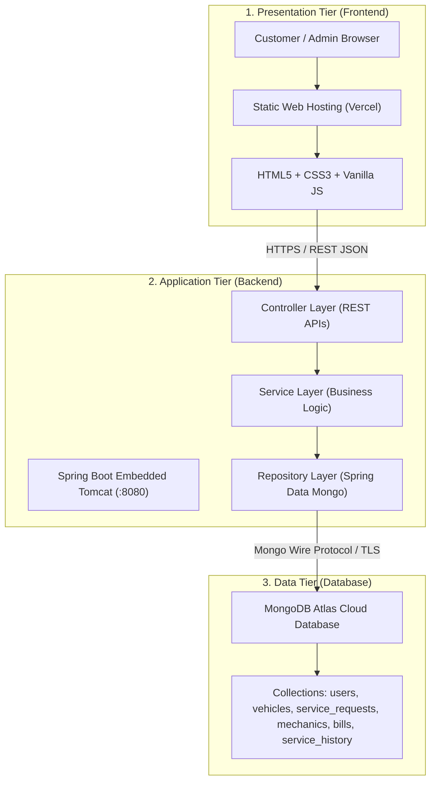

# System Architecture: Vehicle Service Management System (VSMS)

## 1. Overview & Architectural Style
The **Vehicle Service Management System (VSMS)** is designed using the classic **Three-Tier Architecture** pattern. This structure ensures a clean separation of concerns, high maintainability, and ease of explanation for an undergraduate B.Sc. Computer Science college viva.

---

## 2. Detailed Explanation of the Three Tiers

### Tier 1: Presentation Tier (Frontend)
- **Hosted on:** Vercel (or local web server)
- **Technologies:** Semantic HTML5, Vanilla CSS3 (Custom Design System), Vanilla JavaScript (ES6+ Fetch API).
- **Responsibilities:**
  - Rendering responsive UI for both Customers and Workshop Admins.
  - Client-side form validations (phone digit check, email format, non-empty fields).
  - Session state persistence via browser `localStorage` (`vsms_user`).
  - Sending asynchronous JSON HTTP requests (`GET`, `POST`, `PUT`, `DELETE`) to the backend.
  - Displaying friendly user alerts and preventing raw database errors from leaking to users.

### Tier 2: Application Tier (Backend)
- **Hosted on:** Render / Railway / Fly.io / Localhost (Java 17/21 runtime)
- **Technologies:** Java 17 LTS, Spring Boot 3.2.x, Maven, Spring Data MongoDB, `BCryptPasswordEncoder`.
- **Architectural Layers:**
  1. **Controller Layer (`com.vsms.controller`):** Exposes clean RESTful endpoints, handles HTTP status codes (`200 OK`, `201 Created`, `400 Bad Request`, `404 Not Found`), and validates request payloads.
  2. **Service Layer (`com.vsms.service`):** Contains core business rules, auto-ID generation (`SRV-0001`, `BILL-0001`, `MEC-001`), password hashing with BCrypt, mechanic assignment logic, and automatic creation of service history upon completion.
  3. **Repository Layer (`com.vsms.repository`):** Spring Data MongoDB interfaces inheriting `MongoRepository<T, ID>` for type-safe database queries.
  4. **DTO Layer (`com.vsms.dto`):** Data Transfer Objects (`LoginRequest`, `RegisterRequest`, `ApiResponse<T>`) ensuring strict separation of internal models and client contracts.
  5. **Exception Handler (`com.vsms.exception`):** Centralized `@RestControllerAdvice` that catches runtime exceptions, prevents stack trace leakage, and provides structured JSON errors.

### Tier 3: Data Tier (Database)
- **Hosted on:** MongoDB Atlas Cloud Cluster
- **Database Engine:** MongoDB (NoSQL Document Store)
- **Collections:** 6 collections (`users`, `vehicles`, `service_requests`, `mechanics`, `bills`, `service_history`).
- **Security:** Accessible only through encrypted connection strings with credentials held strictly in the backend's environment variables (`MONGODB_URI`).

---

## 3. Request-Response Lifecycle
1. **User Action:** Customer clicks "Book Service" in the browser.
2. **Client Dispatch:** `service-requests.js` invokes `apiPost('/api/services', payload)`.
3. **CORS Inspection:** `CorsConfig` checks the client origin header against permitted domains.
4. **Controller Routing:** `ServiceRequestController.bookRequest()` receives the JSON and binds it to `ServiceRequest`.
5. **Business Logic Execution:** `ServiceRequestService.bookRequest()` validates fields, generates the next sequential `serviceId` (e.g. `SRV-0005`), links customer and vehicle data, and saves.
6. **Data Persistence:** `ServiceRequestRepository.save()` translates the entity into a BSON document in MongoDB Atlas.
7. **Response Return:** Backend wraps the result in `ApiResponse.success(...)` and returns HTTP `201 Created`.
8. **DOM Update:** Frontend displays a success banner with the new tracking ID.

---

## 4. Deployment Architecture & Separation Rationale
**Why can't Spring Boot run directly on Vercel?**
- Vercel is optimized for static sites and lightweight Node.js/Python serverless functions with rapid execution timeouts.
- A Java Spring Boot application is a persistent long-running process with an embedded web server (Apache Tomcat) and the Java Virtual Machine (JVM).
- Therefore, the industry best practice is decoupling:
  - **Frontend:** Vercel (instant global edge CDN, zero maintenance).
  - **Backend:** Render or Railway (dedicated containerized Java runtime).
  - **Database:** MongoDB Atlas (fully managed cloud cluster).
