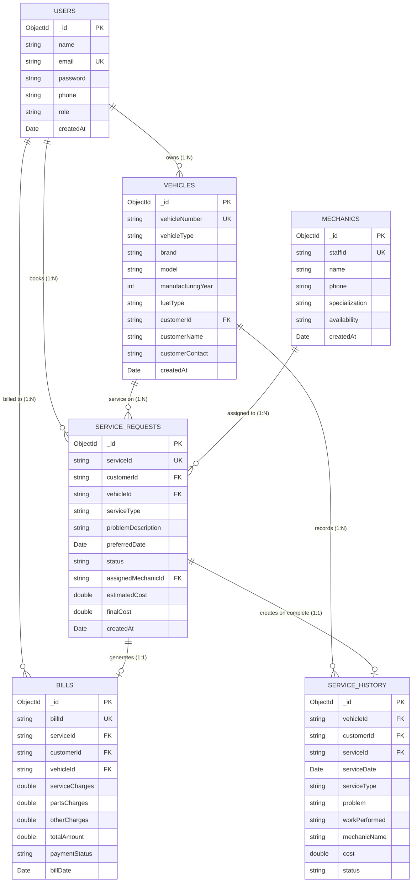

# Database Design & Schema Specification: MongoDB Atlas

## 1. Overview
The database layer for the Vehicle Service Management System (VSMS) uses **MongoDB Atlas**, a cloud-hosted document database. MongoDB stores data in flexible, JSON-like **BSON** documents organized into collections.

There are exactly **six (6)** collections in the system.

---

## 2. Collection Schemas & Field Details

### 2.1 Collection: `users`
- **Purpose:** Manages system users (Customers and Admin staff) with secure hashed passwords.
- **Indexes:** `email` (Unique Index).

| Field Name | BSON Type | Constraints | Description |
| :--- | :--- | :--- | :--- |
| `_id` | ObjectId | Primary Key | Auto-generated MongoDB unique identifier |
| `name` | String | Required | Full name of the user |
| `email` | String | Required, Unique | Login email address (stored lower-case) |
| `password` | String | Required | One-way hashed password using BCrypt |
| `phone` | String | Required | 10-digit mobile contact number |
| `role` | String | Required | `"CUSTOMER"` or `"ADMIN"` |
| `createdAt` | Date | Required | Timestamp of account registration |

---

### 2.2 Collection: `vehicles`
- **Purpose:** Stores customer vehicles serviced by the workshop.
- **Indexes:** `vehicleNumber` (Unique Index), `customerId` (Lookup Index).

| Field Name | BSON Type | Constraints | Description |
| :--- | :--- | :--- | :--- |
| `_id` | ObjectId | Primary Key | Auto-generated unique identifier |
| `vehicleNumber` | String | Required, Unique | License registration plate number |
| `vehicleType` | String | Required | `"Car"`, `"Bike"`, `"Scooter"`, `"SUV"`, `"Other"` |
| `brand` | String | Required | Vehicle manufacturer (e.g., Honda, Hyundai) |
| `model` | String | Required | Model designation (e.g., Civic, Activa) |
| `manufacturingYear` | Integer | Optional | Year of vehicle manufacture (e.g., 2021) |
| `fuelType` | String | Required | `"Petrol"`, `"Diesel"`, `"Electric"`, `"CNG"` |
| `customerId` | String | Foreign Key | Reference to `users._id` |
| `customerName` | String | Denormalized | Cached customer name for fast listing |
| `customerContact` | String | Denormalized | Cached customer phone number |
| `createdAt` | Date | Required | Registration timestamp |

---

### 2.3 Collection: `service_requests`
- **Purpose:** Records workshop service bookings and current maintenance lifecycle.
- **Indexes:** `serviceId` (Unique Index), `customerId` (Lookup Index), `status` (Filter Index).

| Field Name | BSON Type | Constraints | Description |
| :--- | :--- | :--- | :--- |
| `_id` | ObjectId | Primary Key | Auto-generated unique identifier |
| `serviceId` | String | Required, Unique | Human-friendly tracking ID (e.g., `SRV-0001`) |
| `customerId` | String | Foreign Key | Reference to `users._id` |
| `customerName` | String | Denormalized | Customer name cached for reports |
| `vehicleId` | String | Foreign Key | Reference to `vehicles._id` |
| `vehicleNumber` | String | Denormalized | Registration number for quick UI display |
| `serviceType` | String | Required | E.g. General Service, Oil Change, Brake Service |
| `problemDescription` | String | Optional | Notes or complaints entered by customer |
| `preferredDate` | Date | Required | Preferred appointment date |
| `status` | String | Required | `"Requested"`, `"Confirmed"`, `"In Service"`, `"Completed"`, `"Cancelled"` |
| `assignedMechanicId` | String | Foreign Key | Reference to `mechanics._id` (if allocated) |
| `assignedMechanicName` | String | Denormalized | Mechanic name |
| `estimatedCost` | Double | Default 0.0 | Preliminary repair quotation |
| `finalCost` | Double | Default 0.0 | Final settled cost |
| `createdAt` | Date | Required | Booking creation timestamp |

---

### 2.4 Collection: `mechanics`
- **Purpose:** Maintains mechanic staff profiles, specializations, and availability.
- **Indexes:** `staffId` (Unique Index).

| Field Name | BSON Type | Constraints | Description |
| :--- | :--- | :--- | :--- |
| `_id` | ObjectId | Primary Key | Auto-generated unique identifier |
| `staffId` | String | Required, Unique | Formatted employee code (e.g., `MEC-001`) |
| `name` | String | Required | Mechanic's full name |
| `phone` | String | Optional | Mobile number |
| `specialization` | String | Required | E.g. Engine, Electrical, Suspension |
| `availability` | String | Required | `"Available"` or `"Busy"` |
| `createdAt` | Date | Required | Creation timestamp |

---

### 2.5 Collection: `bills`
- **Purpose:** Stores invoices generated for completed or ongoing service work.
- **Indexes:** `billId` (Unique Index), `customerId` (Lookup Index).

| Field Name | BSON Type | Constraints | Description |
| :--- | :--- | :--- | :--- |
| `_id` | ObjectId | Primary Key | Auto-generated unique identifier |
| `billId` | String | Required, Unique | Invoice identifier (e.g., `BILL-0001`) |
| `serviceId` | String | Foreign Key | Reference to `service_requests.serviceId` |
| `customerId` | String | Foreign Key | Reference to `users._id` |
| `customerName` | String | Denormalized | Customer name on invoice |
| `vehicleId` | String | Foreign Key | Reference to `vehicles._id` |
| `vehicleNumber` | String | Denormalized | Vehicle plate number on invoice |
| `serviceCharges` | Double | Non-negative | Labor/servicing charges |
| `partsCharges` | Double | Non-negative | Replaced spare parts cost |
| `otherCharges` | Double | Non-negative | Consumables, tax, or fees |
| `totalAmount` | Double | Computed | Total: `service + parts + other` |
| `paymentStatus` | String | Required | `"Pending"` or `"Paid"` |
| `billDate` | Date | Required | Invoice issue date |

---

### 2.6 Collection: `service_history`
- **Purpose:** Permanent historical log of completed vehicle service records.
- **Indexes:** `vehicleId` (Lookup Index), `customerId` (Lookup Index).

| Field Name | BSON Type | Constraints | Description |
| :--- | :--- | :--- | :--- |
| `_id` | ObjectId | Primary Key | Auto-generated unique identifier |
| `vehicleId` | String | Foreign Key | Reference to `vehicles._id` |
| `vehicleNumber` | String | Denormalized | Registration number |
| `customerId` | String | Foreign Key | Reference to `users._id` |
| `serviceId` | String | Foreign Key | Reference to `service_requests.serviceId` |
| `serviceDate` | Date | Required | Completion date |
| `serviceType` | String | Required | Category of service performed |
| `problem` | String | Optional | Initial complaint |
| `workPerformed` | String | Required | Summary of work carried out |
| `mechanicName` | String | Required | Name of mechanic who completed work |
| `cost` | Double | Required | Final invoiced amount |
| `status` | String | Required | `"Completed"` |

---

## 3. Database Design Highlights for Viva
1. **Document Embedding vs. Referencing:**
   - Referencing with primary keys (`_id`, `serviceId`) is used to maintain normalized relational integrity.
   - Selective denormalization (storing `customerName` and `vehicleNumber` inside `service_requests` and `bills`) prevents expensive multi-table joins while maintaining rapid read latency for high-frequency dashboard queries.
2. **Auto-Triggered History Insertion:**
   - Whenever an administrator advances a `service_request` status to `"Completed"`, the Java service layer automatically writes an immutable history snapshot into `service_history` and frees up the assigned mechanic's availability flag.
